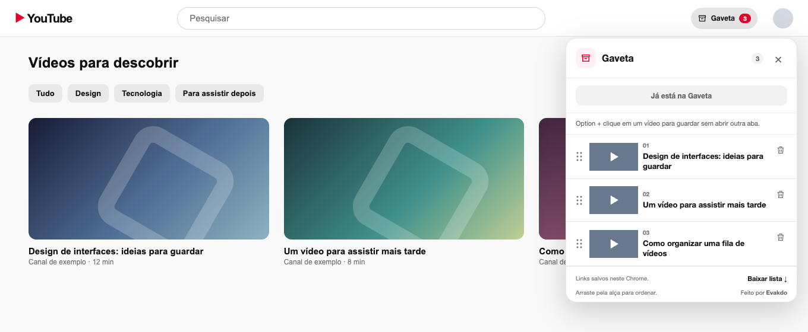

# Gaveta

Extensão para guardar vídeos do YouTube numa fila local, sem abrir uma aba para cada vídeo. Gratuita e feita por [**Evakdo**](https://evakdo.com/).

**Beta 0.6.0 ·** Ainda não está na Chrome Web Store.

**Português** · [English](README.en.md)

*Prévia da interface em uma página de teste, com vídeos fictícios. [Modo escuro](assets/preview-dark.png) · [Gaveta vazia e atalho](assets/preview-empty.png) · [Demo ilustrada (15 s)](assets/gaveta-demo.mp4)*

## Instalar no Chrome

1. [Baixe o repositório em ZIP](https://github.com/evaldopedrosa/gaveta/archive/refs/heads/main.zip) e descompacte.
2. Abra `chrome://extensions` e ative **Modo do desenvolvedor**.
3. Clique em **Carregar sem compactação** e selecione a pasta que contém `manifest.json`.
4. Recarregue as abas do YouTube que já estavam abertas.

Para atualizar, substitua os arquivos, clique em **Recarregar** no cartão da Gaveta e atualize as abas do YouTube. A fila continua salva no mesmo perfil do Chrome.

## Usar

- Na home ou na busca do YouTube, passe o mouse sobre uma miniatura e clique em **+**. **Option + clique** no Mac ou **Alt + clique** nos outros sistemas também guarda o vídeo.
- Clique em **Gaveta** no topo do YouTube para abrir a fila. Arraste os vídeos para reordenar, use a lixeira para remover ou baixe uma cópia em CSV.
- Ao abrir um vídeo pela fila, ele é removido dela, também com **Command/Ctrl + clique** ou clique do meio. Na página do vídeo, a Gaveta indica quando ele já está salvo.
- A gaveta acompanha o modo claro ou escuro do sistema e mostra o atalho quando está vazia.

## Dados

A lista contém links, títulos e datas e fica em `chrome.storage.local`, neste perfil do Chrome. A Gaveta não baixa vídeos, não exige conta e não envia a lista a um servidor próprio. As miniaturas são carregadas do YouTube quando a fila está aberta. O limite é de 300 vídeos.

Desinstalar a extensão apaga a fila. Exporte a lista em CSV para manter uma cópia. Consulte a [política de privacidade](PRIVACIDADE.md).

## Código

`content.js` exibe a interface e `background.js` gerencia a fila. Para verificar a lógica de armazenamento com Node.js, execute `node tests/background.cjs`.

A interface está em português. Mudanças no layout do YouTube podem exigir ajustes na detecção das miniaturas. Gaveta é um projeto independente, sem afiliação ao YouTube ou ao Google.
